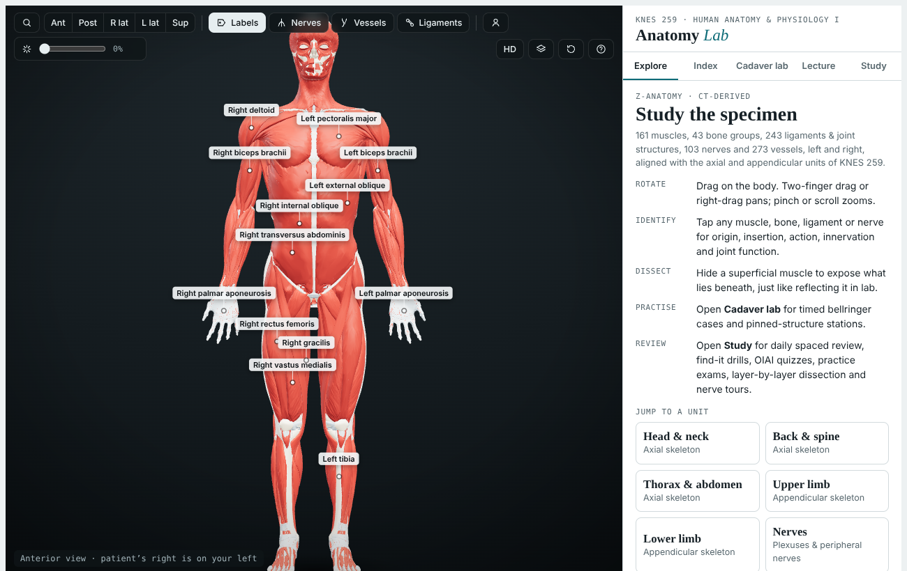
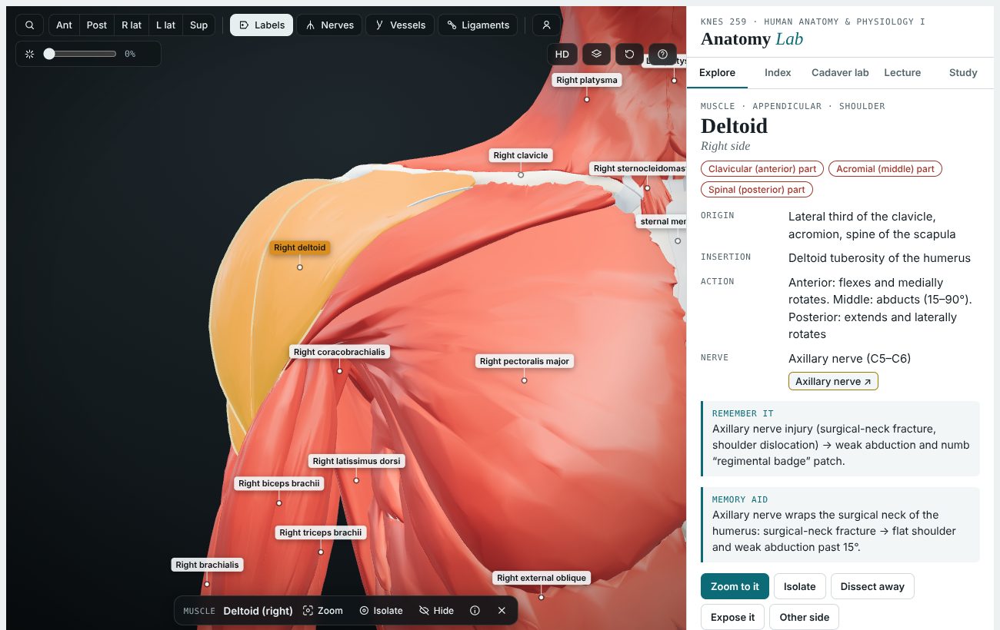
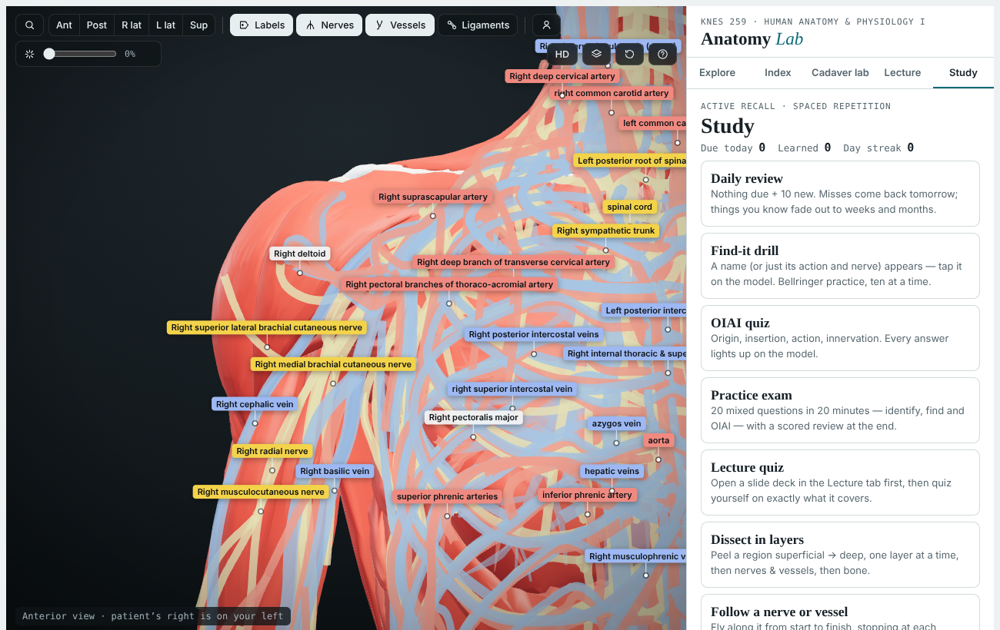

# Anatomy Lab: KNES 259

An interactive 3D anatomy study tool for **KNES 259, Human Anatomy & Physiology I**. You can rotate a full human model, dissect it layer by layer, practise lab bellringers, follow your lecture slides, and quiz yourself with spaced repetition. Everything runs in the browser, and the optional AI tutor uses Claude.



| Select any structure | Nerves and vessels |
|---|---|
|  |  |

## What's inside

**The model**
- 161 muscles, 43 bone groups, 243 ligaments and joint structures, about 130 nerves (every brachial plexus root, trunk, division and cord, and all 12 cranial nerves) and about 270 vessels, on both sides of the body. Most of the geometry comes from Z-Anatomy, built on BodyParts3D scan data.
- Nerves and vessels are drawn at their true thickness. You can view them on their own or see them through the muscles.
- Explode view, region and side filters, muscle opacity, a cadaver colouring mode and an HD mesh pack (about 5.5 million triangles).

**Learning**
- **Explore:** click any structure to see its origin, insertion, action, innervation, clinical notes, memory aids and a longer "About" section.
- **Index:** search by name, action or nerve. Press `/` anywhere for quick find.
- **Cadaver lab:** timed bellringer cases and pinned-structure stations, like a lab practical.
- **Lecture:** open a PDF or PPTX deck and the model follows each slide. A numbered tracker matches every term on the slide to one structure on the model (the same numbers appear as tags on the model), and lists anything not in the specimen, and on-device OCR (Tesseract) reads labels inside slide pictures.
- **Study:**
  - daily spaced-repetition review
  - find-it drills
  - origin, insertion, action and innervation (OIAI) quizzes
  - a timed practice exam
  - a lecture quiz
  - layer-by-layer dissection
  - nerve and vessel fly-through tours
  - weak-spot tracking

**AI tutor (optional)**
- **Tutor chat:** can highlight and isolate structures on the model while it explains.
- **Explain with AI:** a cadaver-focused explanation for any structure.
- **AI clinical cases:** new bellringer scenarios for the region you choose.
- **Why?:** an explanation after any quiz answer.
- **AI slide reading:** reads labels in lecture slide pictures.

The AI features need the page to be opened as a Claude artifact. They run on the viewer's own Claude account and only when the viewer clicks one. Without Claude, the AI buttons hide and everything else works offline.

**Keyboard shortcuts**

| Key | Action |
|---|---|
| `/` or `Ctrl K` | Find a structure |
| `1`–`5` | Anterior, posterior, right lateral, left lateral and superior views |
| `L` / `N` / `V` / `G` | Labels, nerves, vessels, ligaments |
| `C` | Cadaver colouring |
| `E` | Explode |
| `F` / `I` / `H` | Zoom to, isolate or hide the selection |
| `R` | Reset |
| `?` | Help |

## Run it

The app is plain static files with no build step. It has to be served over HTTP; opening the file directly won't work.

```bash
cd app
python3 -m http.server 8000
# open http://localhost:8000
```

It works on any static host, for example GitHub Pages with the source set to `/app`. Add `?lite=1` to the URL to force the low-graphics mode on weak devices.

## Tests

```bash
node test/harness.js                      # fast logic test: stubbed DOM and WebGL, mocked AI
npm i playwright && node test/browser-smoke.js   # real Chromium render; serve app/ on port 8766 first
```

## Repository layout

| Path | Contents |
|---|---|
| `app/index.html` | The whole application (HTML, CSS and JS) |
| `app/manifest.json`, `app/anatomy.txt` | Standard mesh pack: base64 of gzip of quantised positions, indices and per-vertex shading data |
| `app/hd.json`, `app/hd1-4.txt` | HD mesh pack, loaded on demand |
| `app/nerves.json`, `app/vessels.json` | Nerve and vessel paths with a radius at each point |
| `app/content.json` | Course notes: OIAI, nerves, vessels, bones, ligaments, bellringers, mnemonics |
| `app/defs.json` | "About" text for each structure |
| `app/eng.txt` | Tesseract English model, so OCR works offline |
| `app/lib/` | Local copies of three.js r147 |
| `tools/` | Build scripts: `.blend` reader, mesh conversion, ligament and nerve builders, content generators |
| `test/` | Node harness and browser smoke test |

## Licences

This project combines original code with openly licensed anatomy data:

- **Source code** (`app/index.html`, `tools/`, `test/`): [MIT](LICENSE).
- **3D models and anatomy data** (`app/*.txt` mesh packs, `manifest.json`, `nerves.json`, `vessels.json`, `defs.json`): [CC BY-SA 4.0](LICENSE-DATA.md). They are derived from Z-Anatomy and BodyParts3D, with "About" text adapted from Wikipedia.
- **Third-party libraries:** three.js (MIT), Tesseract and its English model (Apache 2.0), and pdf.js and JSZip, loaded at runtime (Apache 2.0 and MIT).

See [LICENSE-DATA.md](LICENSE-DATA.md) for the full attributions.

---

*This is a study aid, not a medical reference. Your lab specimens and course notes are the authority.*
